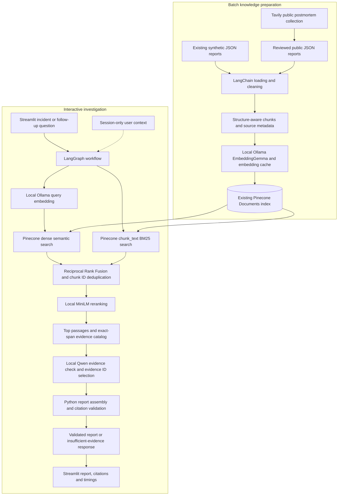

# Submission architecture diagram

This describes the active local Week 2 application, not every historical plan in the project. It is a documentation artifact; no application or cloud resources were changed to create it.

## How to read the diagram

The preparation path runs as a deliberate batch: reviewed public and synthetic JSON reports become LangChain documents, cleaned chunks, cached local embeddings, and records in the existing Pinecone index. Tavily is a collection tool, not a live chat-search dependency.

The investigation path starts in Streamlit. LangGraph invokes the existing hybrid retriever. Pinecone searches dense vectors and full-text `chunk_text`; RRF combines rank positions and removes duplicate chunk IDs. MiniLM reranks up to ten candidates and returns up to five passages. When reranking is unavailable, the system reports that state and retains RRF order.

Python builds an exact-span evidence catalog. Local Qwen checks sufficiency and selects allowed evidence IDs. Python copies source text and validates IDs, metadata, offsets, quotations and source roles before displaying a report. Unsupported or invalid selections return an insufficient-evidence response. Historical findings are distinct from unconfirmed current hypotheses.

## Boundaries and configuration

| Boundary | Active configuration |
| --- | --- |
| Knowledge corpus | 34 reports: 20 synthetic and 14 public; 104 processed chunks |
| Embeddings | Local Ollama `embeddinggemma:300m`; 768 dimensions; compatible cached document vectors reused |
| Hosted index | Pinecone Documents API, `incident-rca`, namespace `historical-incidents`; AWS `us-east-1`; deletion protection configured |
| Index fields | Dense `embedding` with cosine similarity; full-text `chunk_text`; stable IDs and incident/source metadata |
| Retrieval | Separate semantic and BM25 branches; RRF constant 60; up to ten fused candidates and five final passages |
| Reranking | Cached local CPU `cross-encoder/ms-marco-MiniLM-L6-v2` |
| Generation | Local Ollama `qwen3.5:4b`; context 8,192 tokens; output limit 1,800; strict local JSON/schema validation |
| Conversation | Bounded user context in `st.session_state`; may disappear when the session ends; never documentary evidence |
| External services | Pinecone for search/storage; Tavily for approved collection; local model inference does not make the complete application offline |

## Intentionally outside the active graph

Mem0 is an optional integration developed earlier and disabled because credits were limited. `config/memory.toml` sets `enabled = false`; graph/client/adapter guards prevent hosted memory calls. Remote records are not deleted. There is no persistent resume or cross-session recall in the active UI.

Nebius is paused. Future PDF parsing through LlamaParse is an extension point rather than current JSON processing. No authentication layer, production deployment, scheduled collection, or automated repair is represented.

## Use in Google Docs

Render this Mermaid block with a Mermaid-capable viewer and insert an exported image into the report at its architecture placeholder. Keep a readable caption: “Batch preparation and interactive investigation; local models with hosted Pinecone retrieval.” This file provides the diagram source; it does not claim that an image was exported or published.

## Sources

[Provider settings](../config/providers.toml), [retrieval settings](../config/retrieval.toml), [ingestion summary](../data/processed/ingestion_summary.json), [existing architecture history](architecture.md), [Phase 9 report](../evaluation/publication_safe/PHASE9_REPORT.md), and [main submission](gen_academy_submission.md).
