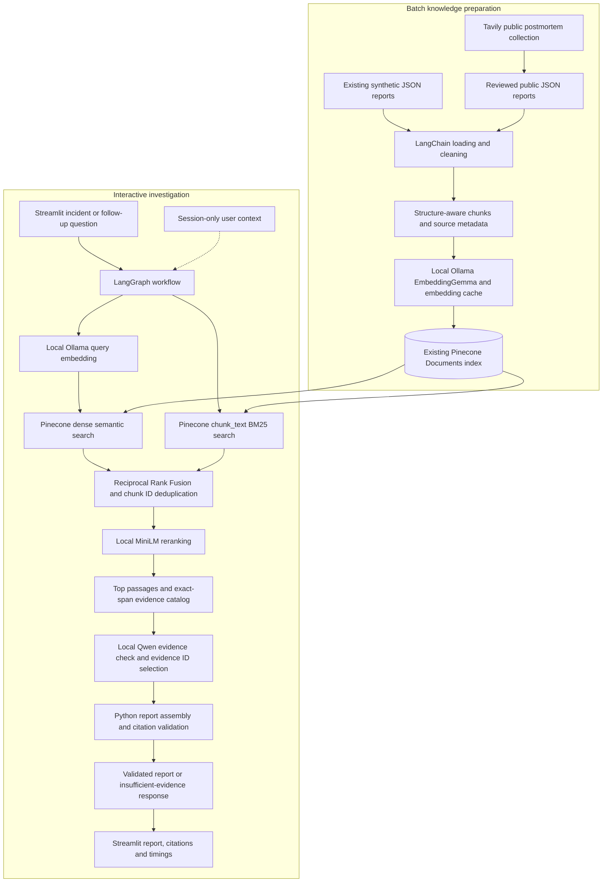

# AI Incident Root Cause Investigator
## Gen Academy Week 2 — Final Project Submission

**Author:** [ADD YOUR NAME]  
**GitHub repository:** [ADD GITHUB REPOSITORY URL]  
**Five-minute demonstration:** [ADD DEMO VIDEO URL]  
**Application status:** Runs locally; not deployed.  
**Documentation review:** October 25, 2026. Results below are from saved evaluation artifacts, not a new evaluation run.

*Google Docs preparation:* Copy the rendered report, apply Google Docs heading styles, and retain the tables and source links. Replace the screenshot placeholders. Google Docs does not render Mermaid source directly; insert a diagram image rendered from `docs/architecture_diagram.md` in its place. No screenshots or video are represented as already supplied.

## 1. Executive summary

IT support and on-call engineers often need to investigate an outage before they know its cause. Useful evidence may be scattered across old incident reports. Searching only for exact words can miss similar failures described differently, while an unconstrained language model can offer plausible but unsupported explanations.

I built a local Streamlit application that retrieves relevant historical incident passages and produces a structured investigation report with traceable citations. Its knowledge base contains synthetic training examples and genuine public engineering postmortems. Engineers can compare symptoms, inspect documented causes and fixes, and ask follow-up questions within the current session. Historical explanations remain distinct from unconfirmed possibilities about a current incident.

The project demonstrates an end-to-end RAG workflow: collection, cleaning, chunking, local embeddings, hosted vector search, hybrid retrieval, reranking, evidence selection, and citation validation. The final reliability iteration accepted 11 of 12 answerable evaluation questions and correctly declined all four insufficient-evidence questions. These are development-set observations, not production guarantees. The application supports investigation; it does not diagnose a live system conclusively or execute repairs.

## 2. RAG project one-liner

> My RAG app helps IT support and on-call engineers answer questions about similar incidents, documented causes, and previous fixes from a corpus of historical incident reports in a local Streamlit interface with 93.3% observed claim support as a faithfulness proxy.

This follows the Gen Academy user–question–corpus–surface–measurement framework. The percentage is **42/45 claims supported in coding-assistant qualitative review**, not an independently measured probability of correctness. Separately, the original retrieval evaluation found all required reference evidence in the top five for **12/12 answerable questions**. This measures reference coverage, not universal relevance of every returned passage. Neither number is a target presented as an achieved production score.

## 3. RAG framework

| Required field | Project implementation |
| --- | --- |
| Use case | Help engineers find similar incidents, inspect historical causes and resolutions, compare failures, and recognize when evidence is insufficient. |
| Corpus | 34 incident reports: 20 explicitly fictional synthetic examples and 14 public reports attributed to their original publishers. |
| Ingestion and cleaning | Custom LangChain JSON loader validates records, normalizes Unicode and whitespace, preserves technical terms and source attribution, and rejects invalid or duplicate records. Missing public structured facts remain missing; they are not invented. |
| Ingestion and freshness | Manual, repeatable batch ingestion. Local outputs are replaced atomically, and content/model fingerprints support embedding reuse. Source URLs and retrieval metadata aid traceability. There is no scheduled public-source refresh or automatic freshness guarantee. Changed sources require a deliberate reprocessing and indexing review. |
| Chunking and embedding | Section-aware splitting targets approximately 400–600 tokens, with 75-token overlap for longer reports. Actual stored chunks range from 93 to 590 tokens. Ollama `embeddinggemma:300m` supplies verified 768-dimensional vectors. |
| Retrieval | Existing Pinecone Documents API dense cosine search and BM25 search over `chunk_text`; stable-ID deduplication and Reciprocal Rank Fusion; local MiniLM reranking; return up to five passages from a fused candidate set of up to ten. |

## 4. Architecture

The application uses local models with a hosted search database. It is not an entirely offline application: Pinecone requests require network access, and Tavily was used during public-data collection.

| Component | Responsibility and reason for choosing it |
| --- | --- |
| Tavily | Collect public postmortem material during an approved, bounded batch run. Human-directed source review favors original engineering reports. It is not called automatically for each investigation. |
| LangChain | Provide document and text-processing components so ingestion has a consistent representation and can be extended. |
| Ollama | Run embeddings and language generation locally, reducing dependence on hosted inference credits. EmbeddingGemma embeds text; Qwen selects evidence for reports. |
| Pinecone | Store existing dense vectors, searchable passage text, and source metadata in the same Documents index. |
| BM25 | Match technical terms and error codes through full-text search. |
| RRF | Combine semantic and keyword rank positions without treating their different raw scores as directly comparable. |
| MiniLM | Compare each candidate passage with the question and improve the final ordering locally. |
| LangGraph | Make analysis, retrieval, evidence checking, generation, and validation explicit workflow steps. |
| Streamlit | Provide incident submission, reports, source references, follow-up questions, progress, and timing information. |

The existing index is `incident-rca`, namespace `historical-incidents`, on AWS `us-east-1`. Its dense field `embedding` uses 768 dimensions and cosine similarity; `chunk_text` supports full-text search. Deletion protection is configured. Stable chunk identifiers allow repeat uploads to update matching records rather than create duplicates. This documentation phase creates or changes no resources.

**[INSERT ARCHITECTURE DIAGRAM IMAGE FOR GOOGLE DOCS]**

Mem0 was developed as an optional persistent-memory integration, then disabled because hosted credits were limited. It is excluded from the active Week 2 stack and evaluation. Its code is retained, remote memories are untouched, and disabled-mode safeguards block hosted calls. Nebius remains paused. LlamaParse is an extension direction for future PDFs, not an active parser for this JSON corpus. No deployment is claimed.

## 5. Dataset and attribution

The corpus contains **20 synthetic reports and 14 public reports**, producing **104 processed chunks**: 20 synthetic chunks and 84 public chunks. Synthetic examples provide clearly labeled fields for symptoms, errors, causes, and resolutions. They are fictional teaching examples and must not be presented as real outages.

Public reports come from Cloudflare, GitHub, GitLab, and Spotify. Each retains a source URL and publisher information alongside its local source file. Public prose is less uniform than synthetic records: a structured cause or resolution can be absent even when the narrative discusses it. The application does not invent missing fields.

Ingestion reads `data/incidents/synthetic/` and `data/incidents/public/`, writes `data/processed/chunks.jsonl`, and records validity and chunk counts in the ingestion summary. The saved summary reports no invalid documents or missing incident IDs. Every chunk retains incident and source metadata. The local embedding verification records 104 embeddings: the public-data expansion generated 84 and reused 20 compatible cached embeddings. That verification predates Pinecone creation; its historical `pinecone_created=false` flag is not the current database status.

The original reports remain separate from derived chunks. Duplicate checks use incident IDs, normalized public URLs, titles, and content hashes. Public-source attribution does not establish redistribution permission; repository publication should respect each publisher's terms and avoid exposing credentials or private local artifacts.

**[INSERT SCREENSHOT: HOME SCREEN, INCIDENT INPUT, AND SESSION-ONLY NOTE]**

Public source inventory is included in Appendix B.

## 6. Development methodology

I used VS Code with Codex for incremental, prompt-driven development, often called vibe coding. I described the intended behavior, asked for code and simple explanations, and imposed boundaries on each phase. My role was to review the proposed behavior, approve paid or resource-creating steps, and learn why the components were needed. This is an assisted engineering project, not a claim that I independently designed every implementation detail.

The work progressed from a basic Streamlit project to synthetic data, repeatable ingestion, public-source expansion, local embeddings, approved Pinecone integration, hybrid search, investigation generation, optional memory, and the complete UI. Hosted memory was subsequently disabled. Evaluation separated retrieval from generation so missing evidence and generation failures could be investigated independently. Reliability changes were tested offline before separately approved local-model evaluations.

Validation developed with the system: ingestion checked traceable IDs and content; embedding checks verified dimensions and valid vectors; indexing checks verified stored records and metadata; retrieval tests covered matching, fusion, deduplication and empty results; generation tests covered malformed output, missing evidence, quotations, citations and fallback behavior. Saved regression results also cover Streamlit and session-only behavior.

Recorded instructions show these decisions were deliberate. Examples from the actual development conversation include:

- “Pause the Nebius integration. I do not have Nebius API credits yet.”
- “Disable Mem0 completely without affecting the existing RAG functionality.”
- “Do not loosen validation thresholds merely to improve acceptance rates.”
- “Preserve the original baseline results unchanged.”

The recorded Phase 6 request called for a LangGraph workflow with accurate citations; Phase 8 requested reuse of existing backend functions rather than duplicate implementations. These are real development instructions, not reconstructed model prompts. A complete exported prompt transcript is not included in these deliverables; selected excerpts above document the process without claiming such a transcript exists in the repository.

## 7. Technical implementation

### Ingestion, chunks, and embeddings

The JSON loader converts valid reports into LangChain Documents. Unicode and whitespace cleaning preserve meaning, capitalization, error codes, and source identity. Recursive splitting prefers section, paragraph, line, and sentence boundaries. Short documents remain short; long documents receive overlap to preserve context. The tokenizer used to measure chunks is `cl100k_base`, so these counts are a processing measure rather than the model's exact native token counts.

Stable chunk IDs combine incident identity and chunk number. Every record retains original text and metadata including title, category, affected service, source type, source URL when available, source path, and chunk number. Embedding cache fingerprints include content, model identity, and processing configuration. Reuse therefore depends on compatibility, not just matching vector dimensions. Vector checks reject empty, zero, non-finite, or inconsistent outputs.

### Hybrid retrieval and reranking

A question is embedded locally using the same embedding model and query-specific format. Pinecone performs semantic search and a separate BM25 text search, each returning up to ten results. Semantic search helps when wording differs; BM25 helps with explicit terms such as HTTP 503 or named services.

RRF adds reciprocal rank contributions using a configured constant of 60, deduplicates by stable chunk ID, and retains up to ten candidates. The cached local `cross-encoder/ms-marco-MiniLM-L6-v2` model reranks those candidates and selects up to five. If reranking is unavailable, the application retains RRF ordering and reports that state. Search and reranker scores are ranking signals, not probabilities that a cause is correct.

### Evidence sufficiency and report generation

LangGraph coordinates `analyze → retrieve → check_evidence → generate / insufficient_evidence → validate_citations`. A topic-overlap heuristic and a model evidence check assess sufficiency; neither is a calibrated confidence measure. Similar passages can exist without answering the question.

Phase 9 made generation more extractive. Python builds an evidence catalog from exact spans in retrieved passages and assigns runtime-local fact IDs mapped to actual chunk IDs. Synthetic labeled fields can provide historical causes and resolutions. Untyped public prose remains neutral observations; causal-sounding words do not automatically establish its role as a root cause.

Local `qwen3.5:4b` selects evidence IDs rather than inventing quotations or citation metadata. Python resolves those selections into exact source text and recovers documented synthetic cause/resolution pairs before validation. Optional hypotheses must refer to selected, validated historical cause evidence and use a fixed unconfirmed template. They do not establish the current root cause. Factual questions need not produce a hypothesis.

Configuration bounds the model to an 8,192-token context, 1,800 output tokens, and a 180-second timeout. The recorded local backend did not support native JSON-schema generation, so the application prompts for JSON and then enforces strict Pydantic schemas locally. This is validated structured output, not a claim of native constrained decoding.

### Citation safeguards and session context

Validation checks allowed evidence IDs, retrieved chunk membership, metadata, exact quotations, source offsets, field roles, and hypothesis alignment. Invalid selections fail closed: the application does not silently truncate them, fuzzy-match quotations, or automatically retry until an answer passes. An insufficient-evidence response can offer clearly labeled general diagnostic guidance without representing it as retrieved proof.

Exact citations prove provenance, not complete semantic understanding. A real quotation can still be irrelevant or ambiguous. Streamlit follow-ups use bounded user-written context in `st.session_state`; assistant hypotheses are not replayed as confirmed facts. Context may disappear on reload or session end. There is no active persistent-resume feature or cross-session recall.

**[INSERT SCREENSHOT: ACCEPTED REPORT WITH SOURCE LINKS AND SYNTHETIC/PUBLIC LABELS]**

## 8. Evaluation and results

### Design and measurement definitions

The original dataset contains **16 questions: four exact technical matches, five semantic-similarity questions, three cross-document questions, and four insufficient-evidence questions**. The first three groups contain 12 answerable cases. Retrieval ran first; approved generation runs reused its saved passages. Phase 9 reused the same questions and retrieval so the generation changes could be compared without modifying ranking or index contents.

The evaluation is curated and corpus-derived. Reference labels are incomplete, the same development set informed improvements, and the coding assistant performed the qualitative claim review. There was no independent human adjudication or separate judge-model API. Results are not held-out production accuracy.

| Measure | Original baseline | Final Phase 9 | Meaning |
| --- | --- | --- | --- |
| Required reference evidence found in top five | 12/12 answerable questions; 17/17 reference units | Same cached retrieval | Coverage of the required evidence, not relevance of every result |
| MRR@5 | 1.00 | Same cached retrieval | First required reference ranked first on these answerable cases |
| Accepted answerable reports | 5/12 (41.7%) | 11/12 (91.7%) | Answerable requests that passed report validation |
| False refusals | 7/12 (58.3%) | 1/12 (8.3%) | Answerable requests withheld despite available evidence |
| Correct insufficient-evidence responses | 4/4 (100%) | 4/4 (100%) | Appropriate behavior on the four negative cases |
| Citation provenance checks | 16/16 (100%) | 45/45 (100%) | Valid source identity and quotation provenance, not semantic correctness |
| Qualitatively supported exposed claims | 24/25 (96.0%) | 42/45 (93.3%) | Coding-assistant support review; unclear claims count against support |
| Overall expected task behavior | 8/16 (50%) | 15/16 (93.75%) | Required task evidence and abstention behavior |
| Automated regression tests | 69 passed | 83 passed | Saved offline suite outcomes, not live model accuracy |

The final claim review found three unclear public fragments and no identified source contradictions. The supported-claim fraction did **not** improve; increased acceptance should not be described as an increase in faithfulness. The outputs also became more extractive, so the claim mix changed. A task can meet its core expected behavior while containing an unclear auxiliary excerpt.

No current hypotheses were selected in the final factual/comparison evaluation. Live hypothesis-support performance therefore cannot be inferred from this run. Offline tests exercise actor, negation, and hypothesis-citation preservation.

The original strict judged precision@5 was 0.2833, based only on curated reference labels. Because other relevant passages were not exhaustively labeled, it is not a complete precision estimate or a claim that all other results were irrelevant. Required-reference coverage and MRR should be read with that limitation.

### Latency and test evidence

The baseline generation stage took **732.973 seconds**, compared with **588.817 seconds** for the final Phase 9 run. Mean answerable response time changed from **55.419 to 39.389 seconds**. Each used **28 local chat requests**. These timings used cached retrieval and include the generation-stage workflow; they are not a fresh end-to-end latency benchmark or a separately isolated reranking measurement. The original retrieval run took **31.083 seconds**, with reranking active for all 16 questions.

The final saved suite reports **83 passing regression tests**: 69 existing tests with schema fixtures adapted and 14 new reliability tests. The recorded dependency check found no broken requirements. These checks include citation, generation, disabled-memory, retrieval, and Streamlit behavior. No tests or expensive evaluations were rerun to write this submission.

The remaining false refusal was C03, the mixed synthetic/public DNS comparison. The model returned 40 finding IDs against a schema maximum of 20, and validation correctly rejected the structure. Limits were not relaxed or the result silently truncated.

**[INSERT SCREENSHOT: INSUFFICIENT-EVIDENCE RESPONSE]**  
**[OPTIONAL: INSERT BASELINE/PHASE 9 COMPARISON TABLE SCREENSHOT]**

## 9. Iterations and improvements

1. **Broaden the corpus.** The original synthetic examples gave predictable structure. Adding reviewed Tavily public postmortems introduced real engineering language, narrative complexity, and source attribution.
2. **Use local inference.** Planned Nebius inference was paused because credits were unavailable. Ollama enabled local embeddings and generation, with measured embedding dimensions before database configuration.
3. **Improve retrieval.** Hybrid semantic/BM25 search addressed both paraphrases and exact technical terms. RRF combined rankings, and MiniLM reranked the resulting candidates.
4. **Separate evidence from wording.** Baseline failures occurred even when required evidence was retrieved. Evidence-ID selection and deterministic source extraction reduced fragile quote copying and citation alignment failures without relaxing validation.
5. **Correct an unsuccessful intermediate revision.** The first Phase 9 experiment accepted 10/12 answerable cases but introduced two unsupported public root-cause labels. Its report was preserved. The safer revision treats untyped public excerpts as observations instead of inferring causal roles from keywords.
6. **Simplify memory dependencies.** Mem0 integration was retained for possible future use but disabled in the active application. Session-only conversations meet the current interaction scope without hosted-memory credit dependence.

## 10. Failures and lessons learned

**Retrieval success is not answer success.** All required baseline passages were present, yet seven answerable questions were refused. Six failed a combined hypothesis-citation alignment condition; one failed quotation membership against the cited public chunk. Rejected raw baseline drafts were not retained, so the exact offending ID cannot be reconstructed in every case. Requiring a current hypothesis for factual questions was also an unnecessary structural constraint.

**Correct citations do not prevent incorrect causal interpretation.** An accepted baseline DNS comparison reversed which server restarted. Exact quote checks alone did not catch that interpretation. The redesign restricts causal wording and validates source roles, but it does not prove arbitrary semantic entailment.

**Public excerpts need context.** Clipped continuation fragments can lose their subject. Three such fragments remain unclear in the final review. Treating them as supported merely because they are real text would overstate quality.

**Local generation has a usability cost.** The measured response times can be noticeable during an investigation. Bounded context, output limits, selected evidence, and embedding reuse help control work. Future latency experiments must preserve citation quality and report actual measurements.

**Fail-closed validation is a tradeoff.** It prevents malformed or unsupported outputs from being presented as reliable, but can refuse useful answers. The C03 limit failure remains visible rather than being hidden by a metric-driven exception. The practical lesson is to improve evidence representation and generation structure before weakening safeguards.

## 11. Limitations and future work

- **Access control:** The local demonstration does not provide production authentication or multi-user authorization. Hosting would require a separate security and deployment design.
- **Session-only context:** Conversation history is temporary. No persistent recall is promised while Mem0 is disabled.
- **Corpus scope:** Public reports cover selected publishers and incidents, while synthetic reports are fictional. The collection is small and not representative of every IT environment. Public-report licensing and attribution need review before redistribution.
- **Freshness:** Updates are manual. There is no automatic continuous collection, stale-document removal, or production freshness SLA.
- **Evidence interpretation:** Public observations are not automatically classified as causes or fixes. Unclear fragments, extra sources, duplicates, and incomplete answers remain possible. The current incident's cause still requires operational evidence.
- **Evaluation independence:** A larger held-out set, exhaustive relevance judgments, and independent human claim review are future work. The current score does not establish general performance.
- **Model speed and structure:** Local generation is comparatively slow and can exceed output-structure limits. Future work could assess context selection and output budgeting without changing the evidence standard.
- **Operational readiness:** No production deployment, automated remediation, or guaranteed repair is claimed. Mem0 remains an optional future integration, subject to credits and explicit re-enablement.

## 12. Conclusion

I completed a practical RAG application that connects a traceable incident corpus to hybrid retrieval and evidence-grounded investigation reports. The strongest improvement came from treating generation as a controlled evidence-selection task rather than relying on unrestricted prose with citations added afterward.

This project taught me that RAG quality depends on the whole system: document preparation, stable metadata, complementary search methods, workflow design, source validation, and honest evaluation. The final application is a working local learning project with documented strengths and remaining failures, rather than a production root-cause authority.

## Appendix A. Evidence and reproducibility references

**Publication note:** Evaluation links below point to labeled publication copies. The question inventory is an unevaluated derivative with summaries and source links; it is not the frozen dataset used for the reported scores. Original local evaluation artifacts are unchanged and excluded from Git. Some links to private derived artifacts remain local evidence references and will not resolve in a public checkout. Use [the synthetic sample guide](reproducing_sample.md) for the reproducible publication workflow.

Links below refer to files in this project. Derived local artifacts may be excluded from Git; their presence locally does not mean they have been published.

| Claim or implementation | Existing source |
| --- | --- |
| Question inventory (unevaluated derivative), split and historical baseline scores | [Publication question summaries](../evaluation/publication_safe/questions.json), [baseline report publication copy](../evaluation/publication_safe/REPORT.md), [baseline reviews publication copy](../evaluation/publication_safe/answer_reviews.json) |
| Final acceptance, refusals, citations, claim support and timings | [Phase 9 report](../evaluation/publication_safe/PHASE9_REPORT.md), [final qualitative reviews](../evaluation/publication_safe/phase9_answer_reviews.json), [comparison metrics](../data/processed/phase9/run2/comparison_metrics.json) |
| Intermediate experiment and source-role failures | [Preserved first-run report](../evaluation/publication_safe/PHASE9_RUN1_REPORT.md) |
| 83 tests, unchanged protected artifacts, disabled memory and call accounting | [Phase 9 verification summary](../data/processed/phase9/verification_summary.json), [saved regression log](../data/processed/phase9/regression_tests.txt) |
| 34 reports, 104 chunks, token range and overlap | [Ingestion summary](../data/processed/ingestion_summary.json), [processed chunks](../data/processed/chunks.jsonl), [ingestion implementation](../src/incident_investigator/ingestion.py) |
| 104 cached embeddings, dimensions, reuse | [Embedding verification](../data/local_embeddings/verification.json) |
| Model names, context/output settings, retrieval limits | [Providers](../config/providers.toml), [retrieval configuration](../config/retrieval.toml) |
| Active behavior and historical phase records | [README](../README.md), [existing architecture documentation](architecture.md), [submission architecture diagram](architecture_diagram.md) |
| Evidence selection and citation enforcement | [Evidence catalog](../src/incident_investigator/evidence_catalog.py), [investigation workflow](../src/incident_investigator/investigation.py) |
| Memory disabled and session UI | [Memory configuration](../config/memory.toml), [UI implementation](../src/incident_investigator/ui.py) |

All reported evaluation numerators, denominators, and timings are transcribed from existing reports and saved metrics. Dataset and configuration numbers are supported by local dataset artifacts and configuration, rather than presented as independent evaluation results. The original baseline remains unchanged.

## Appendix B. Public-source inventory

These are the original source references retained in the public JSON records. Listing them attributes the corpus; it does not claim ownership or permission to redistribute full article text.

- **PUB-0fbaebe05b3f** — Cloudflare: [Cloudflare outage on November 18, 2025](https://blog.cloudflare.com/18-november-2025-outage).
- **PUB-132729161ab7** — Cloudflare: [Cloudflare service outage June 12, 2025](https://blog.cloudflare.com/cloudflare-service-outage-june-12-2025?src=content).
- **PUB-169a1c0fb269** — Cloudflare: [Post mortem on the Cloudflare Control Plane and Analytics Outage](https://blog.cloudflare.com/post-mortem-on-cloudflare-control-plane-and-analytics-outage).
- **PUB-3557997fc8b2** — Cloudflare: [Cloudflare incident on March 21, 2025](https://blog.cloudflare.com/cloudflare-incident-march-21-2025).
- **PUB-539796025e31** — GitHub: [DNS Outage Post Mortem](https://github.blog/news-insights/dns-outage-post-mortem).
- **PUB-602939eef59b** — Cloudflare: [A deep dive into Cloudflare’s September 12, 2025 dashboard and API outage](https://blog.cloudflare.com/deep-dive-into-cloudflares-sept-12-dashboard-and-api-outage).
- **PUB-695cb0d11b88** — Cloudflare: [Cloudflare 1.1.1.1 incident on July 14, 2025](https://blog.cloudflare.com/cloudflare-1-1-1-1-incident-on-july-14-2025).
- **PUB-74e36f9a604c** — GitHub: [The August 17 outage, and the work ahead](https://github.blog/news-insights/company-news/the-august-17-outage-and-the-work-ahead).
- **PUB-91a45f737bc2** — Spotify: [Incident Report: Spotify Outage on March 8, 2022](https://engineering.atspotify.com/2022/03/incident-report-spotify-outage-on-march-8).
- **PUB-923ebca890c0** — Cloudflare: [Cloudflare outage on December 5, 2025](https://blog.cloudflare.com/5-december-2025-outage).
- **PUB-bbd98be895de** — Cloudflare: [Cloudflare incident on February 6, 2025](https://blog.cloudflare.com/cloudflare-incident-on-february-6-2025).
- **PUB-c7e282c7cab3** — GitLab: [Postmortem of database outage of January 31](https://about.gitlab.com/blog/postmortem-of-database-outage-of-january-31).
- **PUB-f3602faa9d13** — GitHub: [October 21 post-incident analysis](https://github.blog/news-insights/company-news/oct21-post-incident-analysis).
- **PUB-f389f6f351e1** — Cloudflare: [Today's Outage Post Mortem](https://blog.cloudflare.com/todays-outage-post-mortem-82515).
